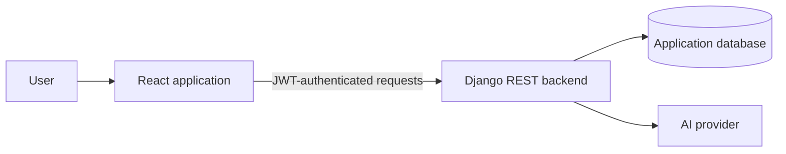

# ManageMyDocument — Frontend

React frontend for a document-management portal with authentication, document workflows and AI-assisted question answering.

## Features

- User registration and login.
- Authenticated document dashboard.
- Upload, view, update and delete document workflows.
- AI question-answering interface backed by the server API.

## Architecture



## Technology

React · JavaScript · Axios · JWT · CSS / HTML

## Local development

```bash
git clone https://github.com/Sandeep-kumar-IITR/ManageMyDocument.git
cd ManageMyDocument
npm install
npm start
```

The development server starts using the scripts defined in `package.json`.

## Configuration

Configure the backend base URL using the frontend environment-variable convention supported by this project (for Create React App, variables exposed to browser code use the `REACT_APP_` prefix).

**Do not put Gemini, Hugging Face, database, or other private API keys in frontend environment variables.** Browser-exposed values are visible to users. Keep provider credentials on the backend and let the frontend call your authenticated API.

## Related project

- [ManageMyDoc backend](https://github.com/Sandeep-kumar-IITR/ManageMyDoc)

## Deployment

The original project notes mention Netlify hosting. Confirm the current deployment URL and environment configuration before relying on it; deployment availability is not verified here.

## Author

**Sandeep Kumar** · [GitHub](https://github.com/Sandeep-kumar-IITR)
